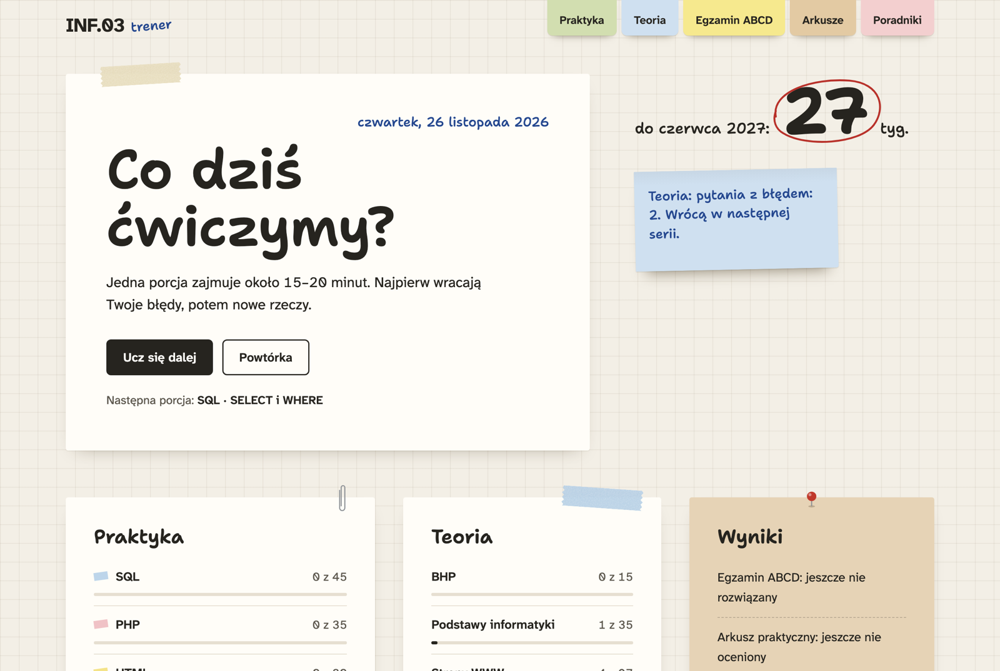
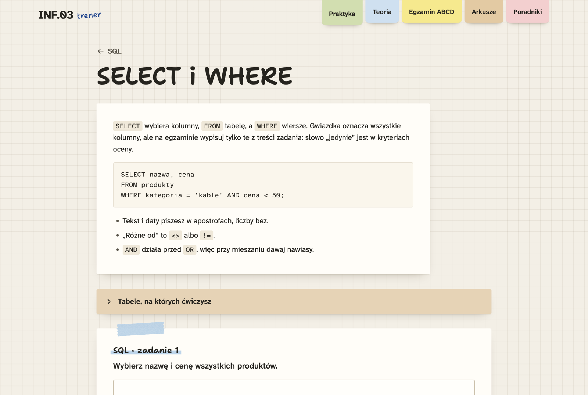
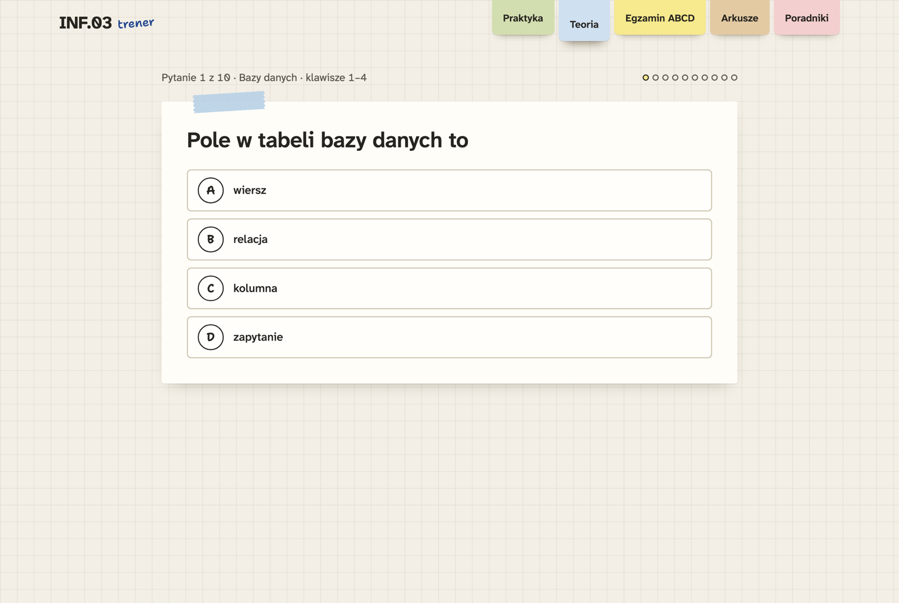
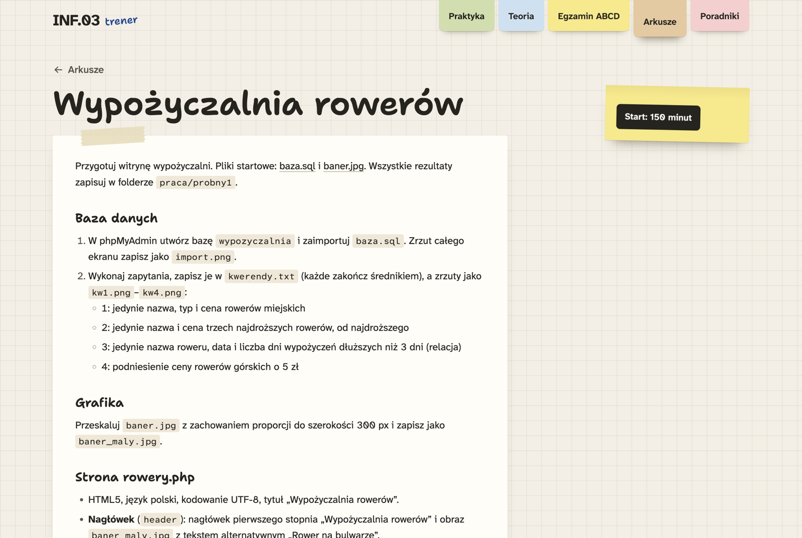

<div align="center">

# Trener INF.03

### Lokalna strona do nauki do egzaminu zawodowego INF.03, z teorią i praktyką sprawdzaną automatycznie

<p>
  
  
  
  
  
</p>
<p>
  
  
  
  
</p>

> Napisz zapytanie. Uruchom. Zobacz, czy wynik zgadza się ze wzorem.



</div>

---

## O projekcie

Lokalna strona do nauki do egzaminu zawodowego **INF.03** (tworzenie i administrowanie
stronami, aplikacjami internetowymi i bazami danych). Obejmuje teorię i praktykę. Działa
offline na Macu z XAMPP, bez kont i chmury. Sama aplikacja nie korzysta z AI.

Zadania nie są sprawdzane po tekście. Twoje zapytanie SQL i Twój skrypt PHP naprawdę się
wykonują, a wynik jest porównywany z wynikiem wzorcowego rozwiązania.

## Co jest w środku

| Część | Zawartość |
|---|---|
| **Praktyka** | 145 zadań w 29 tematach, każdy temat z krótką lekcją: SQL 45, PHP 35, HTML 20, CSS 20, JavaScript 25 |
| **Teoria** | 318 pytań ABCD z 8 działów, losowane serie po 10 (najpierw te, w których się mylisz) |
| **Egzamin ABCD** | 40 pytań w 60 minut, jak na prawdziwym egzaminie |
| **Arkusze** | 2 arkusze próbne oceniane automatycznie (PHP: „Wypożyczalnia rowerów”, JS: „Catering Smakosz”) oraz 11 prawdziwych sesji CKE z zegarem 150 minut i ręcznym wpisem punktów |
| **Poradniki** | egzamin krok po kroku, GIMP, phpMyAdmin i zrzuty ekranu, ściąga ze wzorcami skryptów |
| **Powtórka** | wraca do zrobionych zadań, zaczynając od tych, które nie wyszły |

Postęp zapisuje się w `dane/postep.json`, a gdy serwer nie odpowiada, w pamięci przeglądarki.

<table>
  <tr>
    <td width="33%"></td>
    <td width="33%"></td>
    <td width="33%"></td>
  </tr>
  <tr>
    <td align="center">Lekcja i zadania SQL</td>
    <td align="center">Teoria ABCD</td>
    <td align="center">Arkusz próbny</td>
  </tr>
</table>

## Jak sprawdzane są zadania

- **SQL**: baza ćwiczeń jest odtwarzana od zera, potem wykonywane jest Twoje zapytanie i zapytanie wzorcowe, a wyniki są porównywane. Dla `INSERT`, `UPDATE` i `DELETE` porównywany jest stan bazy po wykonaniu.
- **PHP**: Twój kod naprawdę się uruchamia z danymi z formularza (`$_POST`, `$_GET`, `$_COOKIE`). Wynik, stan bazy i zapisane pliki są porównywane ze wzorem.
- **HTML**: podgląd strony i sprawdzenie, czy wymagane elementy są na miejscu.
- **CSS**: porównanie wyliczonych stylów i położenia elementów z wynikiem wzoru, przy kilku szerokościach okna. Przechodzi każdy poprawny zapis, nie tylko jeden konkretny.
- **JavaScript**: skrypt działa w izolowanej ramce, która klika i wpisuje za Ciebie, a wyniki są porównywane ze wzorem.
- **Arkusze próbne**: pliki z `praca/<arkusz>/` są oceniane według kryteriów podobnych do zasad CKE (31 z 33–34 kryteriów automatycznie, resztę zaznaczasz ręcznie).

## Wymagania

- macOS
- XAMPP 8.2 z włączonym MySQL (MariaDB). Apache nie jest potrzebny, bo aplikacja ma własny serwer PHP.
- Przeglądarka: Chrome, Safari albo Firefox

## Uruchomienie

1. Włącz MySQL w XAMPP.
2. Tylko za pierwszym razem utwórz bazę ćwiczeń i użytkownika, który widzi wyłącznie ją:

   ```bash
   /Applications/XAMPP/xamppfiles/bin/mysql -u root < sql/instalacja.sql
   ```

3. Kliknij dwukrotnie `start.command`. Strona otworzy się pod adresem http://127.0.0.1:8003. Zamknięcie okna terminala wyłącza serwer.

Rozwiązania arkuszy próbnych zapisuj w `praca/probny1/` i `praca/probny2/`.

## Testy

 

```bash
./testy/test.sh
```

Sprawdza zadania SQL i PHP oraz kwerendy arkuszy: wzór ma przejść, a błędne odpowiedzi mają nie przejść. Wymaga włączonego MySQL.

Testy HTML, CSS i JS uruchamiają się w przeglądarce pod adresem http://127.0.0.1:8003/testy/test.html, przy włączonym serwerze.

## Struktura

```
index.html          strona (punkt wejścia)
favicon.png         ikona strony
start.command       uruchomienie serwera dwuklikiem
api.php             serwer: postęp, pliki arkuszy, wywołania sprawdzarki
sprawdz.php         sprawdzanie SQL i PHP (piaskownica)
js/app.js           widoki, nawigacja i postęp
js/zadania.js       sprawdzanie zadań w przeglądarce (HTML/CSS/JS)
css/styl.css        wygląd
css/fonty/          czcionki lokalne (Atkinson Hyperlegible Next i Mono, Shantell Sans; licencja SIL OFL w OFL.txt)
dane/*.js           treść: lekcje, zadania, pytania ABCD, arkusze, poradniki
dane/postep.json    Twój postęp (tworzy się sam, nie trafia do repo)
sql/                instalacja bazy ćwiczeń i dane sklepu do zadań
arkusze/<id>/       baza arkusza, pliki startowe i wzorcowe rozwiązanie (wzor/)
praca/<id>/         tu zapisujesz swoje rozwiązania arkuszy (nie trafiają do repo)
testy/              testy treści i sprawdzarek (test.sh, test.php, test.html)
zrzuty/             zrzuty ekranu do tego pliku
```

## Bezpieczeństwo


Aplikacja uruchamia wpisany przez Ciebie kod PHP, dlatego:

- **Dostęp tylko z Twojego komputera.** Serwer słucha tylko na `127.0.0.1:8003` i sprawdza nagłówek `Host`. Każde żądanie POST wymaga nagłówka `X-INF03`, którego obce strony otwarte w przeglądarce nie mogą wysłać.
- **Ograniczony proces PHP.** Kod działa w osobnym procesie, w tymczasowym folderze (`open_basedir`), bez poleceń systemowych, z limitem 64 MB pamięci i 5 sekund czasu. Po sprawdzeniu folder jest usuwany.
- **Osobna baza.** Zadania łączą się jako użytkownik `inf03cwiczenia`, który ma dostęp tylko do bazy `inf03cwiczenia`. Baza jest odtwarzana przed każdym sprawdzeniem. Kod logujący się jako `root` jest odrzucany.

Zabezpieczenia chronią przed pomyłkami i obcymi stronami. Nie są piaskownicą do uruchamiania cudzego, celowo złośliwego kodu.

Hasło użytkownika ćwiczeń w `sql/instalacja.sql` jest celowo proste: konto działa tylko lokalnie i ma dostęp wyłącznie do bazy ćwiczeń.

## Znane ograniczenia

- Pytania ABCD są napisane od zera przez Claude. Nie pochodzą z banku CKE, który nie jest publiczny, i nikt ich nie weryfikował. Jeśli odpowiedź wygląda na błędną, popraw ją w `dane/abcd.js` lub `dane/abcd2.js` (poprawna jest zawsze pierwsza opcja).
- Zadania SQL mają jeden zestaw danych, więc zapytanie z warunkiem wpisanym „na sztywno” może przejść.
- Prawdziwe sesje to linki do arkusze.pl. Bez internetu nie działają, a plików nie ma w repo.
- Wygląd strony (kolory, „czy ładnie wygląda”) nie jest oceniany automatycznie.

## Pomysły na przyszłość

<details>
<summary><b>Lokalne AI sprawdzające prawdziwe arkusze</b></summary>

<br>

Arkusze próbne sprawdzają się same, ale **prawdziwe sesje CKE trzeba oceniać ręcznie** według zasad oceniania. To długie, nudne i łatwo przy tym ocenić się zbyt łagodnie. Pomysł: lokalny model AI ocenia rozwiązanie kryterium po kryterium.

**Jak mogłoby to działać**

1. Pobrać lokalnie arkusze i zasady oceniania sesji, na przykład do `arkusze/<sesja>/`: `arkusz.pdf`, `zasady.pdf` i pliki startowe.
2. Przepisać zasady oceniania na listę kryteriów w `dane/arkusze.js`, z punktacją i opisem każdego kryterium. Z tej listy korzystałyby zarówno AI, jak i ręczny formularz.
3. Rozwiązanie zapisać w `praca/<sesja>/` (pliki `.php`/`.html`, `.css`, `kwerendy.txt`, zrzuty ekranu).
4. Na stronie sesji przycisk **„Oceń przez AI”** wywołuje w `api.php` nową akcję, na przykład `co=ocenAi`. Ta akcja:
   - zbiera pliki z `praca/<sesja>/` i listę kryteriów,
   - wysyła je do lokalnego modelu przez [Ollama](https://ollama.com) (`http://127.0.0.1:11434/api/chat`, odpowiedź w formacie JSON),
   - dla każdego kryterium dostaje werdykt: spełnione / niespełnione / niepewne, z krótkim uzasadnieniem i wskazaniem linii kodu.
5. Wynik wypełnia istniejący formularz punktów. Kryteria oznaczone jako „niepewne” zostają do ręcznego zaznaczenia, a końcowa decyzja zawsze należy do Ciebie.

**Co sprawdzać czym**

- **Kwerendy SQL** nie potrzebują AI. Wystarczy uruchomić je na bazie z arkusza i porównać z wynikiem kwerend z klucza, tak jak w arkuszach próbnych.
- **Struktura HTML i CSS** to w dużej części sprawdzarka bez AI (selektory, wyliczone style, jak w `ocenArkusz`). AI tylko dla kryteriów opisowych.
- **Skrypt PHP/JS**: model kodu ocenia, czy skrypt robi to, czego wymaga kryterium. Dla PHP można dodatkowo uruchomić skrypt w istniejącej sprawdzarce i dać modelowi wynik.
- **Zrzuty ekranu i grafika** (wymiary, przezroczystość, wygląd): `getimagesize` sprawdza wymiary, a model z obsługą obrazów może ocenić zrzuty.

**Na co uważać**

- Mały lokalny model się myli, dlatego wynik ma być podpowiedzią z uzasadnieniem, a nie ostateczną oceną. Warto porównać kilka ocen AI z własną ręczną, zanim się mu zaufa.
- Model wybrać pod RAM Maca: model kodu około 7–14B parametrów plus osobny mały model z obsługą obrazów do zrzutów. Przed instalacją sprawdzić, co jest aktualnie dostępne w Ollama.
- Pobranie arkuszy i zasad z arkusze.pl oraz modelu to jedyne kroki wymagające internetu. Potem całość ma działać offline, jak reszta aplikacji.
- Wywołanie modelu musi zostać za tymi samymi zabezpieczeniami co reszta `api.php` (Host, `X-INF03`), a Ollama tylko na `127.0.0.1`.

</details>
